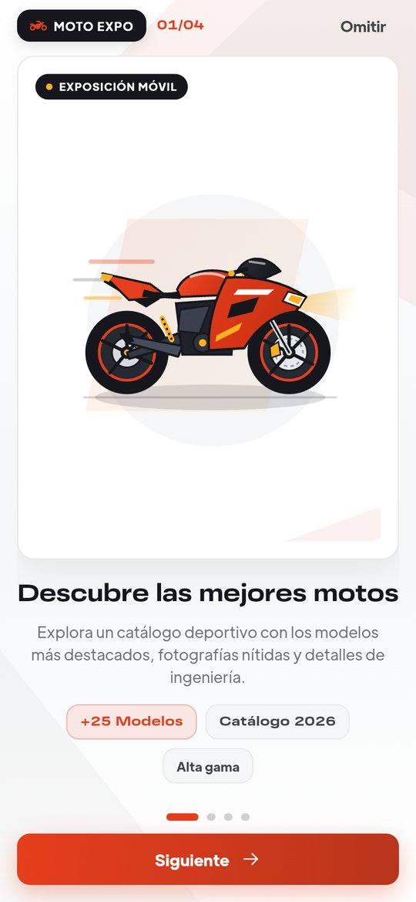
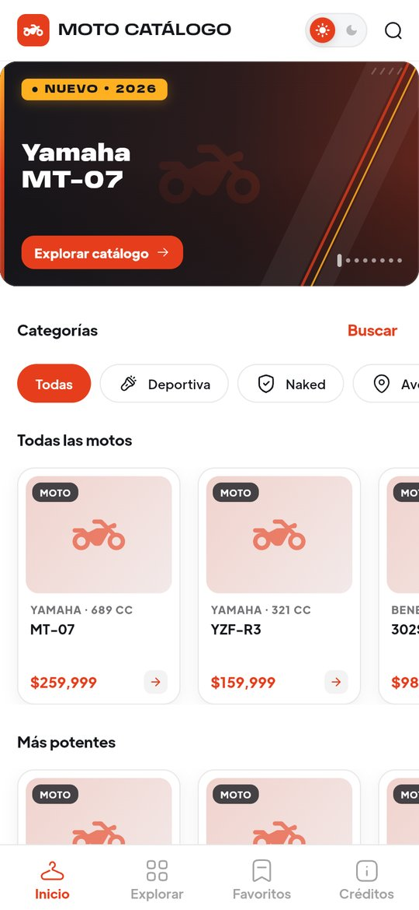
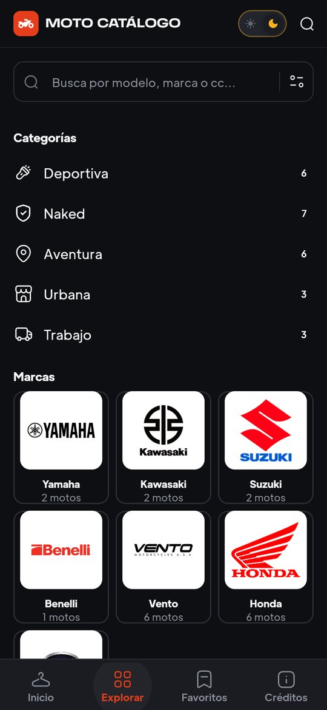
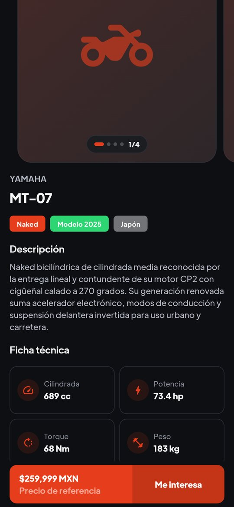

# Catálogo de Motos

App móvil en Flutter para explorar, filtrar y comparar motocicletas del mercado mexicano. Cada moto tiene su ficha técnica con datos reales, galería de fotos y precio de lista en pesos.

Proyecto académico de la materia de **Desarrollo Móvil**. Es una demostración: no hay compras, cuentas ni backend.

<p align="center">
  
  
  
  
</p>

## Funciones

- **25 motos de 7 marcas** (Yamaha, Kawasaki, Suzuki, Honda, Benelli, Vento e Italika) con datos técnicos reales: cilindrada, potencia, torque, peso, asiento, motor, transmisión y tipo de licencia.
- **Ficha técnica** con relación peso/potencia, colores disponibles y enlaces a las fuentes consultadas.
- **Galería de fotos** a pantalla completa con zoom.
- **Comparador** de dos motos lado a lado, con comparativas populares listas para mostrar.
- **Búsqueda y filtros** por categoría, marca y licencia, con orden por precio, potencia o peso.
- **Explorar** por categoría (Deportiva, Naked, Aventura, Urbana, Trabajo) y por marca.
- **Favoritos** para guardar las motos que te interesan.
- **Modo oscuro** automático o manual.

## Cómo correrla

Necesitas [Flutter](https://docs.flutter.dev/get-started/install) 3.x y un celular o emulador Android/iOS. Las fotos se cargan de internet.

```bash
git clone https://github.com/AlexViva0/E-commerce-motos.git
cd E-commerce-motos
flutter pub get
flutter run
```

Pruebas y análisis:

```bash
flutter test
flutter analyze
```

## Estructura

```
lib/
├── models/moto_model.dart   # Motos, marcas, categorías y filtros
├── state/                   # Favoritos y tema (en memoria)
├── screens/                 # Inicio, explorar, búsqueda, ficha, comparador, favoritos, créditos
├── components/              # Tarjetas, banners, filtros y widgets compartidos
└── theme/                   # Paleta, tema claro y oscuro
docs/FUENTES_DATOS.md        # Fuentes de cada ficha técnica
```

Para agregar una moto, añade una entrada a la lista `motos` en `lib/models/moto_model.dart`.

## Datos

Las fichas y los precios se tomaron de los sitios oficiales y distribuidores de cada marca en México en noviembre de 2026. Son de referencia y pueden cambiar. El detalle por moto está en [docs/FUENTES_DATOS.md](docs/FUENTES_DATOS.md).

---

## Créditos

- **Diseño base**: esta app es un fork de [FlutterShop (E-commerce Complete Flutter UI)](https://github.com/abuanwar072/E-commerce-Complete-Flutter-UI) de **Abu Anwar** ([The Flutter Way](https://www.youtube.com/@TheFlutterWay)). Su plantilla gratuita es la base de la interfaz. Aquí la adaptamos a un catálogo de motos.
- **Fotografías**: Wikimedia Commons, con la licencia y autoría de cada archivo, y sitios oficiales de las marcas.
- **Marcas y logotipos**: pertenecen a sus respectivos dueños y se usan solo con fines académicos.
- **Tipografías**: Plus Jakarta Display y Grandis Extended, incluidas en la plantilla original.
